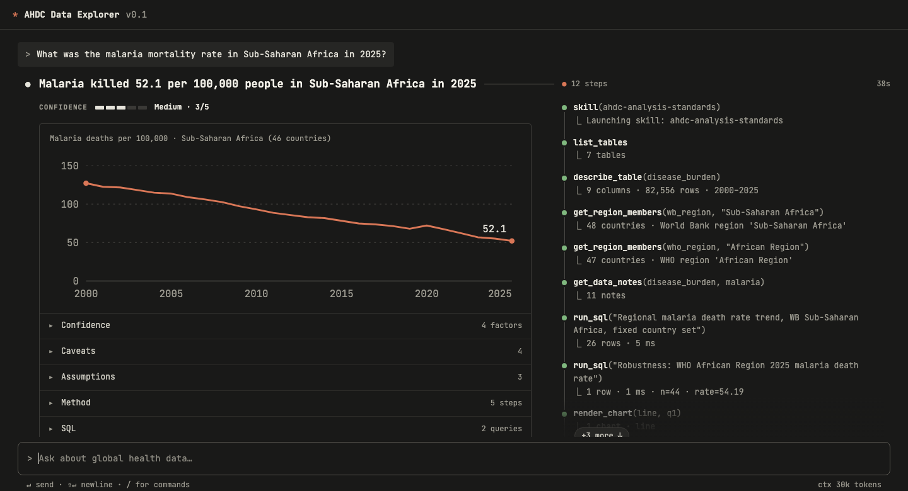

# AHDC Data Explorer

A prototype that lets researchers and policymakers ask the **Anthropic Health Data Collaborative**'s public-health database questions in plain English. It is built on the **Claude Agent SDK** (Python). Each answer arrives with:
- the agent's working shown step by step;
- a confidence rating built from fixed checks;
- the caveats, assumptions and method;
- the exact SQL that ran;
- an independent methods review.

> **All data are synthetic.** They are generated to mirror AHDC's tables (demographics, disease burden, interventions, spending, facilities; 179 countries, 2000–2025), with real-world analytical pitfalls planted on purpose so answers can be checked against ground truth.



## Quick start

Requires macOS or Linux, [uv](https://docs.astral.sh/uv/), and an Anthropic API key.

```bash
cp .env.example .env                       # add ANTHROPIC_API_KEY=sk-ant-...
./run.sh                                   # installs deps, builds the DB, starts http://127.0.0.1:8000
uv run python scripts/preflight.py --live  # optional: checks everything end to end (~$0.03)
```

Try: *"What was the malaria mortality rate in Sub-Saharan Africa in 2025?"*, then *"How does that compare to 2015, and which countries drove the change?"* On an empty prompt, **Tab** fills a demo question. `/new` starts a new session.

There's also an offline replay: **`/?replay=demo`** plays a recorded run of the four demo questions with no API calls.

## Why an agent, and why the Agent SDK

A single text-to-SQL call can return a confident wrong number. Two examples from this data:
- Averaging country rates gives 40.6 per 100,000 for Sub-Saharan African malaria; the population-weighted rate is 52.1.
- "Southeast Asia" can mean three different country lists.

Real questions need an analyst's workflow:
1. find the right table;
2. pin down definitions;
3. check the data notes;
4. query;
5. sanity-check;
6. disclose the caveats.

The Agent SDK provides that loop, plus the controls an institution needs around it:

| Need | SDK feature | Where |
|---|---|---|
| Multi-step work: look things up, query, check, re-query | Agent loop and sessions: `ClaudeSDKClient`, one per conversation; follow-ups keep context | `ahdc_agent/agent.py` |
| Governed access to the data | **Custom tools** on an in-process MCP server (`@tool`, `create_sdk_mcp_server`, `readOnlyHint`). The model can only list, describe and `SELECT` | `ahdc_agent/tools.py` |
| Read-only, auditable, enforced in code (not by prompt) | **`PreToolUse` hook** (sqlglot guard: one `SELECT`, allow-listed tables) plus a read-only DB connection; **`PostToolUse` hook** writes `logs/audit.jsonl` | `ahdc_agent/hooks.py`, `sql_guard.py`, `db.py` |
| The data team's institutional knowledge, editable without code | **Agent Skill** `ahdc-analysis-standards`: aggregation rules, region defaults, data-quality rules, answer format, confidence rubric | `.claude/skills/ahdc-analysis-standards/SKILL.md` |
| A second pair of eyes | **Subagent** `methods-reviewer` (Haiku 5.5, same skill, its own tools). It reads the draft and the queries actually run, and recomputes the headline number independently | `agent.py`, `prompts.py`, `tools.py` |
| Least privilege, and no leakage from a developer's setup | `tools=["Skill","Agent"]` (no shell, files or web), `allowed_tools`, `permission_mode="dontAsk"`, `strict_mcp_config`, `setting_sources=["project"]`, auto-memory off | `agent.py` |
| A UI that shows the work as it happens | `include_partial_messages` (each step appears as soon as the model starts it), `ResultMessage` (cost, tokens, duration), `get_context_usage()` | `agent.py`, `server/app.py` |

### Making answers trustworthy
- **Numbers trace to queries.** The answer's SQL and Source data rows are filled from the queries that actually ran, and charts plot query rows, never numbers the model typed. The model's answer goes through a `submit_answer` tool with a fixed schema.
- **Confidence is a rubric, not the model's opinion.** Four checks (complete data, final rather than provisional data, unambiguous definition, no unresolved method breaks), each `+` or `−`. The score is 5 minus the `−`s, computed by the server.
- **Independent review.** The reviewer recomputes the headline number with its own query. Real catches include "Nigeria drove **most** of the decline" (it's 28%) and "malaria **deaths** fell 33%" (that's the *rate*; deaths fell 16%). The review's outcome is written into the Method section by the server.
- **Evals** with ground truth computed from the database (below).

## Architecture

```
Browser (vanilla JS) ──SSE──▶ FastAPI (server/app.py)
                                 │  one SessionWorker task per browser session
                                 ▼
                       AgentSession (ahdc_agent/agent.py)
                                 │  ClaudeSDKClient ⇄ bundled Claude Code runtime ⇄ Claude API
                                 │     model: claude-sonnet-5-5 · skill: ahdc-analysis-standards
                                 │     hooks: PreToolUse SQL guard · PostToolUse audit log
                                 │     subagent: methods-reviewer (claude-haiku-5-5)
                                 ▼
                 in-process MCP server "ahdc" (ahdc_agent/tools.py)
     list_tables · describe_table · get_region_members · get_data_notes · run_sql
     render_chart · submit_answer · (reviewer only) get_draft · recheck_sql
                                 │  read-only
                                 ▼
                  SQLite data/ahdc.db (stand-in for AHDC's Postgres) + data_dictionary.yaml
```

The design spec for the UI is in `docs/design/DESIGN.md`.

## Evals

```bash
uv run python evals/run_evals.py                          # 15-question golden set
uv run python evals/run_evals.py --only demo --repeat 5   # the 4 demo questions, 5 times each
uv run python evals/run_evals.py --model claude-opus-5-5  # compare models
```

The 15 questions cover regions, weighting, rankings, data notes, normalization, latest-year fallback, admin vs modeled coverage, and a question the data can't answer. Expected values are computed by SQL at grading time, and grading is deterministic. Full results are in `evals/RESULTS.md`.

| Main model | Passed | Median s | Cost / question |
|---|---|---|---|
| **Sonnet 5.5** (default) | 30/30 | 13 | $0.03 |
| Opus 5.5 | 15/15 | 21 | $0.10 |
| Haiku 5.5 | 27/30 (wrong numbers) | 11 | $0.002 |

With the reviewer on: 15/15. The answer is shown at a median of 10.5 s, and the review finishes beside it.

## Other entry points

```bash
uv run python cli.py                                # terminal client (the demo fallback); /new, /quit
uv run python cli.py "q1" "follow-up" --trace       # scripted run; saves raw SDK messages to logs/
uv run python scripts/record_replay.py demo         # re-record the offline replay
uv run pytest                                       # 48 offline tests: data traps, tools, hooks, grader
```

| Setting | Default | Meaning |
|---|---|---|
| `AHDC_MODEL` / `AHDC_EFFORT` | `claude-sonnet-5-5` / `medium` | Main agent |
| `AHDC_REVIEW` / `AHDC_REVIEWER_MODEL` | `1` / `claude-haiku-5-5` | Methods-reviewer subagent |
| `AHDC_FAST` | off | Fast mode (SDK `settings` opt-in) |
| `AHDC_MAX_BUDGET_USD` | `5` | Per-session cost ceiling |

## Repository layout

```
ahdc_agent/   agent.py (SDK options + session) · tools.py · hooks.py · sql_guard.py · db.py · state.py · prompts.py
.claude/skills/ahdc-analysis-standards/SKILL.md     the data team's standards (Agent Skill)
data/         generate.py · data_dictionary.yaml · seed/countries.csv · ahdc.db (generated)
server/       app.py (FastAPI + SSE)
web/          index.html · app.js · styles.css · replays/demo.json
evals/        golden.yaml · grading.py · run_evals.py · RESULTS.md · results/
scripts/      preflight.py · record_replay.py
docs/         screenshot.png · design/ (locked UI spec)
tests/        test_data_traps.py · test_tools.py · test_evals.py
```

## Limits of this prototype, and what production needs
- **Data:** a read-only Postgres replica with statement timeouts, a dedicated read-only role and row-level security instead of SQLite. The data team owns the data dictionary and the skill.
- **Hosting:** each session runs one bundled Claude Code subprocess (state on local disk). Run one container per session on your own infrastructure, or use **Claude Managed Agents** to have Anthropic host the loop and sandbox. Sessions can be resumed (`resume=`, `fork_session=`).
- **Access and identity:** SSO in front of the UI. Pass the user's identity into the hooks for per-user audit and permissions.
- **Observability:** the audit log goes to the warehouse. Enable OpenTelemetry (`CLAUDE_CODE_ENABLE_TELEMETRY`). Alert on cost and latency.
- **Quality:** grow the golden set from real data-team requests (target 50+), run evals in CI on every skill or prompt change, and add "flag this answer" to the eval backlog.
- **Known gaps:** the reviewer can't see facts the analyst established outside SQL queries and lookups. Answers take 10–20 s, and the review 10–20 s more. Headline wording can change after review. The data are synthetic.
